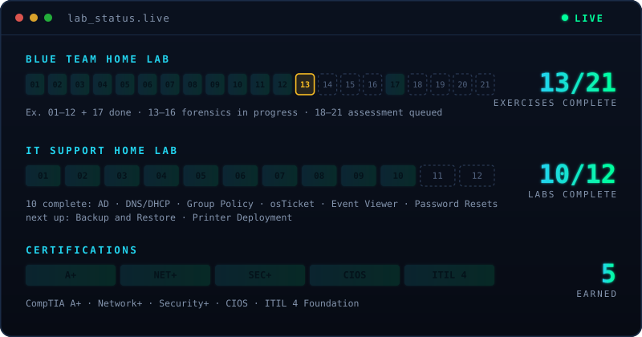
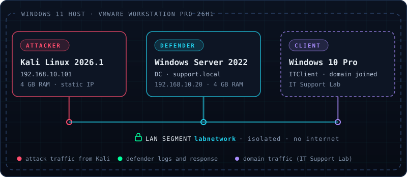

 

 

<h3><code>// OPERATOR PROFILE</code></h3>

  

<h3><code>// LAB STATUS</code></h3>

  

<h3><code>// LAB ARCHITECTURE</code></h3>

  

<h3><code>// CAREER PATH</code></h3>

  

<h3><code>// MISSION FILES</code></h3>

<table>
<tr>
<td valign="top" width="33%">

<h4>🟢 AEGIS OS</h4>
<b>AI CYBERSECURITY PLATFORM</b>
  
A live 16-tool platform powered by GPT-4o: threat analysis, log parsing, CVE lookup, phishing detection, and network recon. Built as a Handshake project with AI-assisted development (OpenAI Codex CLI) and deployed on Vercel. I built the tools around the concepts I was studying, so it doubled as hands-on Security+ prep. Recognized organically by Handshake's official LinkedIn.
  
<code>GPT-4o</code> <code>OpenAI API</code> <code>Vercel</code> <code>JavaScript</code>
  

</td>
<td valign="top" width="33%">

<h4>🔵 BLUE TEAM HOME LAB</h4>
<b>DEFENDER-SIDE DETECTION AND RESPONSE</b>
  
Structured blue team exercises in an isolated VMware environment with a Kali attacker and a Windows Server 2022 defender. 13 exercises complete, each written up as a professional technical report. Digital forensics (Autopsy, Volatility, Windows artifacts, dd) is in progress, with a security assessment set queued.
  
<code>Nmap</code> <code>Hydra</code> <code>Wireshark</code> <code>Wazuh</code> <code>SigmaHQ</code> <code>Autopsy</code>
  

</td>
<td valign="top" width="33%">

<h4>🟡 IT SUPPORT HOME LAB</h4>
<b>ACTIVE DIRECTORY AND WINDOWS SERVER</b>
  
Windows Server 2022 as a domain controller (<code>support.local</code>) with a Windows 10 Pro client, every lab documented as a technical manual. 10 labs complete across Active Directory, DNS and DHCP, Group Policy, osTicket ticketing, Event Viewer, and password resets. Backup and Restore and Printer Deployment are next.
  
<code>Windows Server 2022</code> <code>Active Directory</code> <code>Group Policy</code> <code>osTicket</code> <code>PowerShell</code>
  

</td>
</tr>
</table>

<b>📂 Blue Team Home Lab: completed exercises (13)</b>

 

| # | Exercise | Status |
|---|----------|--------|
| 01 | Lab Setup, Environment Configuration | ✅ |
| 02 | Nmap Network Scan | ✅ |
| 03 | Hydra Brute Force Attack | ✅ |
| 04 | Wireshark Traffic Analysis | ✅ |
| 05 | Active Directory Attack and Defend | ✅ |
| 06 | Home SIEM with Wazuh | ✅ |
| 07 | SigmaHQ Detection Rules | ✅ |
| 08 | Honeypot Deployment and Analysis | ✅ |
| 09 | PCAP Analysis | ✅ |
| 10 | Incident Response Playbook | ✅ |
| 11 | Phishing Email Analysis | ✅ |
| 12 | Vulnerability Scan and Report | ✅ |
| 17 | Digital Forensics Capstone | ✅ |

 

<h3><code>// TECH ARSENAL</code></h3>

<b>🔧 Full tool list</b>

 

**🔒 Security and Defense**

**🖥️ Infrastructure and OS**

**🎫 Ticketing and ITSM**

**💻 Languages and Scripting**

**☁️ Cloud and AI**

 

<h3><code>// CREDENTIALS</code></h3>

-OCC%20%7C%202026%20%7C%20Summa%20Cum%20Laude%20%7C%203.907%20GPA-006633?style=for-the-badge&logoColor=white)

 

<h3><code>// OPERATIONAL HISTORY</code></h3>

| | Role | Organization | Period | Focus |
|---|------|--------------|--------|-------|
| 🟢 | **AI Prompt Trainer** | Handshake (Contract) | 2025 to Present | Prompt evaluation and feedback pipelines for AI models |
| 🔵 | **Customer Support and Compliance Specialist** | ACD Direct (Contract) | Jul 2025 to Jun 2026 | ServiceNow ticketing, PCI DSS compliance, VoIP support, Microsoft 365 |
| 🟡 | **Logistics and Compliance Operator** | Penske Logistics / Cardinal Logistics | Jan 2015 to Dec 2025 | DOT, ELD, FMCSR compliance, SLA-driven operations, technical documentation |

 

<h3><code>// MISSION QUEUE</code></h3>

| Status | Objective | Detail |
|--------|-----------|--------|
| 🟢 **IN PROGRESS** | Digital forensics set | Blue Team Ex. 13 to 16: Autopsy, Volatility, Windows artifacts, dd |
| 🟣 **IN PROGRESS** | WGU B.S. Cybersecurity and IA | Expected Dec 2027 |
| 🔵 **QUEUED** | Security assessment set | Blue Team Ex. 18 to 21 |
| 🟡 **QUEUED** | IT Support Lab | Backup and Restore, Printer Deployment |
| ⚪ **PLANNED** | CySA+ / CEH | Mid-term cert roadmap |
| 🟢 **ACTIVE** | Land an IT Support role | NJ in person or remote |

 

<h3><code>// LIVE STATS</code></h3>

 

<h3><code>// MISSION STATEMENT</code></h3>

> *"I came from a decade behind the wheel, where one missed inspection could end my career or a life. That discipline is what I bring to IT. Every ticket matters. Every system matters. Every user matters. I'm not here to pass certs, I'm here to build things that work and protect the people who depend on them."*

 

<h3><code>// ESTABLISH CONNECTION</code></h3>

 

<code>[ STATUS: ACTIVE OPERATOR · BUILDING IN PUBLIC · OPEN TO OPPORTUNITIES ]</code>

