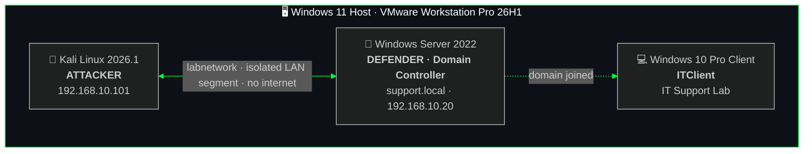

<div align="center">


<br/>

**`[ CompTIA A+ | Network+ | Security+ | CIOS | ITIL 4 | WGU B.S. Cybersecurity — In Progress ]`**

<br/>

[](https://www.linkedin.com/in/stevenjfernandez31)
[](https://github.com/sjfernandez31)
[](https://aegis-os-orcin.vercel.app)
[](https://github.com/sjfernandez31/sjfernandez31/raw/main/IT%20Tech%20Resume.pdf)

</div>

---

## `〈 SYSTEM INFO 〉`

```
┌──(steven㉿fernandez)-[~]
└─$ neofetch

▄▄▄▄▄▄▄▄▄▄▄▄▄▄▄  steven@fernandez
███████ ███████  ────────────────────────────────────────────────
███████ ███████  Role    : Entry-Level IT Support · Cybersecurity Student
 █████████████   Certs   : A+ · Net+ · Security+ · CIOS · ITIL 4
  ███████████    Degree  : B.S. Cybersecurity & IA, WGU (Dec 2027)
   █████████     Lab     : VMware · Kali · Windows Server 2022 · AD
    ▀█████▀      Langs   : English · Spanish
      ▀█▀        Status  : Open to work · NJ / Remote
```

```
┌──(steven㉿fernandez)-[~]
└─$ ./status.sh

  BLUE TEAM LAB    ██████░░░░   13 / 21 exercises complete
  IT SUPPORT LAB   ████████░░   10 / 12 labs complete

  CERTS EARNED     ✔ A+   ✔ Network+   ✔ Security+   ✔ CIOS   ✔ ITIL 4
  EDUCATION        ✔ A.S. (OCC, Summa Cum Laude, 3.907 GPA)   ▸ B.S. (WGU, in progress)
  NOW BUILDING     ▸ Digital forensics set (Autopsy, Volatility, Windows artifacts, dd)
```

**What sets me apart:**

- 🛡️ **Bilingual (EN/ES)**, able to support diverse user bases in two languages
- 🖥️ **Active home lab operator**, Windows Server 2022 AD environments and VMware, with documented labs across two repos
- ⚡ **AegisOS builder**, deployed a live 16-tool AI-powered cybersecurity platform (GPT-4o + Vercel), built while studying for Security+
- 📋 **Compliance-trained**, PCI DSS, ServiceNow ticketing, and VoIP support at ACD Direct
- 🔐 **Blue Team mindset**, Nmap scanning, Hydra brute-force defense, Wireshark PCAP analysis, Wazuh SIEM, SigmaHQ detection rules, and forensics with Autopsy
- 📦 **CDL-A background**, DOT, ELD, and FMCSR compliance translates directly into process discipline

---

## `〈 LAB ARCHITECTURE 〉`



---

## `〈 CAREER PATH 〉`

```mermaid
%%{init: {'theme':'dark','themeVariables':{'primaryColor':'#0d1117','primaryTextColor':'#c9d1d9','primaryBorderColor':'#00FF41','lineColor':'#00FF41'}}}%%
flowchart LR
    A["🚛 CDL-A Driver<br/>10 yrs logistics"] --> B["📜 A+ · Net+ · CIOS<br/>ITIL 4"]
    B --> C["🎓 A.S. Computer Science<br/>Ocean County College"]
    C --> D["🔐 Security+<br/>Aug 2026"]
    D --> E["🖥️ IT Support / Help Desk<br/><b>targeting now</b>"]
    E --> F["🛡️ SOC / Security Analyst"]
    F --> G["☁️ Cloud Security Engineer<br/><b>long term</b>"]

    classDef done fill:#0d1117,stroke:#00FF41,color:#00FF41,stroke-width:2px;
    classDef now fill:#003b1f,stroke:#00FF41,color:#ffffff,stroke-width:3px;
    classDef next fill:#0d1117,stroke:#8b949e,color:#8b949e,stroke-dasharray: 5 5;
    class A,B,C,D done;
    class E now;
    class F,G next;
```



---

## `〈 MISSION FILES — LIVE PROJECTS 〉`

### 🟢 AEGIS OS — AI CYBERSECURITY PLATFORM
> ⚡ *A live 16-tool AI-powered cybersecurity platform, recognized by Handshake's official LinkedIn*

A live web application powered by GPT-4o with tools covering threat analysis, log parsing, CVE lookup, phishing detection, network recon, and more. Built as a Handshake project using AI-assisted development with OpenAI Codex CLI and deployed on Vercel. I built the tools around the concepts I was studying, so it doubled as hands-on prep for my Security+ exam.

`GPT-4o` `OpenAI API` `Vercel` `JavaScript` `Prompt Engineering` `Cybersecurity`

[](https://aegis-os-orcin.vercel.app)
[](https://github.com/sjfernandez31/AegisOS)

---

### 🔵 BLUE TEAM HOME LAB
> ⚡ *Defender-side detection, analysis, and response, built to simulate real SOC workflows*

Structured blue team exercises in an isolated VMware environment with a Kali Linux attacker and a Windows Server 2022 defender. 13 exercises complete, each documented as a professional technical report. A digital forensics set (Autopsy, Volatility, Windows artifacts, dd) and a security assessment set are next.

`Nmap` `Hydra` `Wireshark` `Wazuh` `SigmaHQ` `Autopsy` `Windows Event Logs` `VMware Workstation` `Incident Response`

<details>
<summary><b>📂 View completed exercises (13)</b></summary>

<br/>

| # | Exercise | Status |
|---|----------|--------|
| 01 | Lab Setup, Environment Configuration | ✅ |
| 02 | Nmap Network Scan | ✅ |
| 03 | Hydra Brute Force Attack | ✅ |
| 04 | Wireshark Traffic Analysis | ✅ |
| 05 | Active Directory Attack and Defend | ✅ |
| 06 | Home SIEM with Wazuh | ✅ |
| 07 | SigmaHQ Detection Rules | ✅ |
| 08 | Honeypot Deployment and Analysis | ✅ |
| 09 | PCAP Analysis | ✅ |
| 10 | Incident Response Playbook | ✅ |
| 11 | Phishing Email Analysis | ✅ |
| 12 | Vulnerability Scan and Report | ✅ |
| 17 | Digital Forensics Capstone | ✅ |

</details>

[](https://github.com/sjfernandez31/Blue-Team-Home-Lab)

---

### 🟡 IT SUPPORT HOME LAB — ACTIVE DIRECTORY & WINDOWS SERVER
> ⚡ *A full enterprise-style AD environment built from scratch and documented as technical manuals*

Windows Server 2022 as a domain controller (`support.local`) with a Windows 10 Pro client, and every lab documented as a technical manual. 10 labs complete covering Active Directory, DNS and DHCP, Group Policy, osTicket ticketing, Event Viewer, and password resets. Backup and Restore and Printer Deployment labs are next.

`Windows Server 2022` `Active Directory` `VMware Workstation Pro` `Group Policy` `DNS` `DHCP` `osTicket` `PowerShell`

[](https://github.com/sjfernandez31/it-support-home-lab)

---

## `〈 TECH ARSENAL 〉`

<div align="center">


</div>

<details>
<summary><b>🔧 Full tool list</b></summary>

<br/>

**🔒 Security & Defense**


**🖥️ Infrastructure & OS**


**🎫 Ticketing & ITSM**


**💻 Languages & Scripting**


**☁️ Cloud & AI**


</details>

---

## `〈 CREDENTIALS & CLEARANCES 〉`

<div align="center">


-OCC%20%7C%202026%20%7C%20Summa%20Cum%20Laude%20%7C%203.907%20GPA-006633?style=for-the-badge&logoColor=white)

</div>

---

## `〈 OPERATIONAL HISTORY 〉`

```
🟢  AI PROMPT TRAINER — Handshake (Contract)
    2025 – Present
    Training AI models via structured prompt evaluation and feedback pipelines.

🔵  CUSTOMER SUPPORT & COMPLIANCE SPECIALIST — ACD Direct (Contract)
    Jul 2025 – Jun 2026
    ServiceNow ticketing · PCI DSS compliance · VoIP support · Microsoft 365

🟡  LOGISTICS & COMPLIANCE OPERATOR — Penske Logistics / Cardinal Logistics
    Jan 2015 – Dec 2025
    DOT · ELD · FMCSR compliance · SLA-driven ops · technical documentation

🎓  B.S. Cybersecurity & Information Assurance — WGU (Expected Dec 2027)
🎓  A.S. General Studies (CS Concentration) — Ocean County College (2026) — Summa Cum Laude | 3.907 GPA
```

---

## `〈 FUTURE MISSION QUEUE 〉`

```
╔═ OPERATION: NEXT LEVEL ═══════════════════════════════════════
║
║  🟢  Blue Team Ex. 13-16    Digital forensics set
║  🔵  Blue Team Ex. 18-21    Security assessment and reviews
║  🟡  IT Support Lab         Backup/Restore, Printer Deployment
║  🔵  WGU B.S. Cybersecurity Expected Dec 2027
║  🟡  CySA+ / CEH            Mid-term cert roadmap
║  🟢  Land IT Support Role   NJ in-person or remote
║
╚═══════════════════════════════════════════════════════════════
```

---

## `〈 LIVE STATS DASHBOARD 〉`

<div align="center">

[](https://git.io/streak-stats)


</div>

---

## `〈 MISSION STATEMENT 〉`

> *"I came from a decade behind the wheel, where one missed inspection could end my career or a life. That discipline is what I bring to IT. Every ticket matters. Every system matters. Every user matters. I'm not here to pass certs, I'm here to build things that work and protect the people who depend on them."*

---

## `〈 ESTABLISH CONNECTION 〉`

<div align="center">

[](https://www.linkedin.com/in/stevenjfernandez31)
[](https://aegis-os-orcin.vercel.app)
[](https://github.com/sjfernandez31)

<br/>


<br/>

<sub><code>[ STATUS: ACTIVE OPERATOR — BUILDING IN PUBLIC — OPEN TO OPPORTUNITIES ]</code></sub>


</div>
